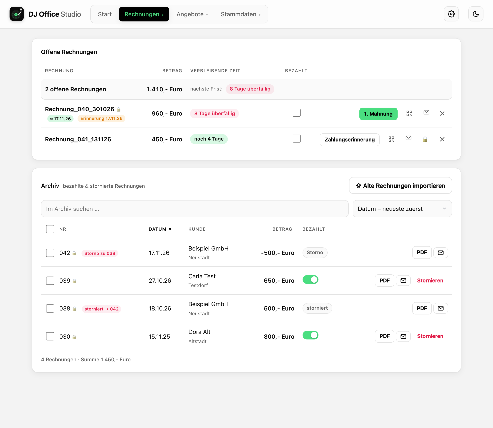
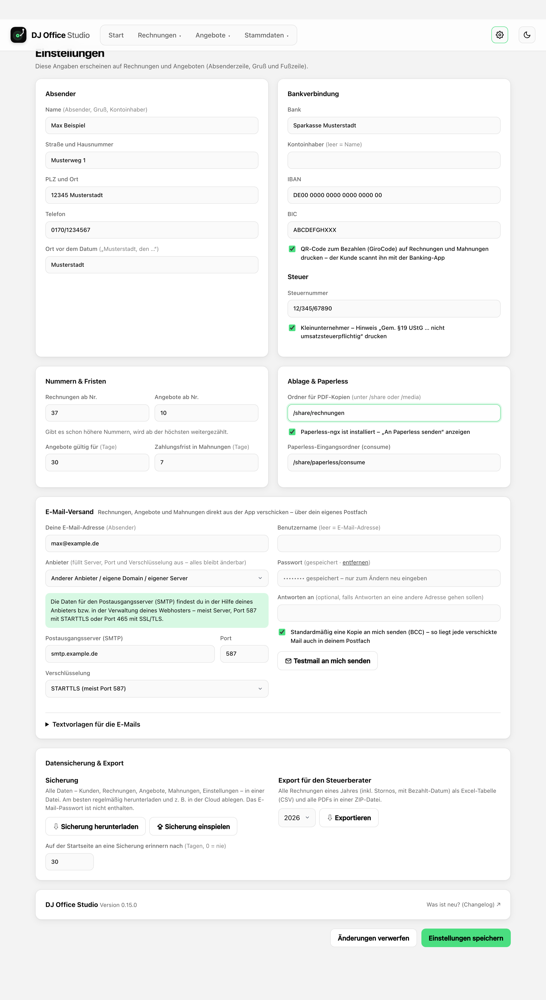

# DJ Office Studio

DJ Office Studio ist eine App zum Schreiben von DJ-Rechnungen und -Angeboten – als App für Home Assistant oder eigenständig unter Windows und macOS. Kunden auswählen, Rechnungsposten und Uhrzeiten eintragen, Preis festlegen – fertig ist das PDF.


## Funktionen

- **Startseite** mit Kacheln für alle Aktionen der App und dem Status der Rechnungen: offene Rechnungen mit Restzeit und Warnung bei Überfälligkeit, Umsatz nach Monat/Jahr und die letzten Rechnungen.
- **Rechnungseditor**
  - Kunde mit Autovervollständigung aus bisherigen Kunden; neue Kunden werden beim Speichern automatisch angelegt
  - Positionen per **Rechnungsposten** (Hochzeit, Geburtstag, Firmenfeier, …) mit **von/bis-Zeiten** – der Rechnungstext wird daraus erzeugt, z. B. „DJ – Tätigkeit Hochzeit – 17:00 Uhr bis 2:00 Uhr“
  - Freitext-Positionen für alles andere (z. B. Fahrtkosten)
  - Preis wird pro Position individuell eingetragen
  - Auswählbare Zahlungsbedingungen (Überweisung 8/14 Tage, bar erhalten, …)
  - Fortlaufende Rechnungsnummer (dreistellig, Startwert einstellbar)
- **PDF** im A4-Layout mit Absenderzeile, Adressfeld, Positionstabelle und Fußzeile (Bankverbindung, Steuernummer, Kleinunternehmer-Hinweis nach §19 UStG). Vorschau vor dem Speichern; beim Speichern wird eine Kopie im Ordner `/share/rechnungen` abgelegt.
- **Offene Rechnungen** auf einen Blick: eine Summenzeile mit Anzahl, Gesamtbetrag und nächster Frist; darunter je Rechnung Rechnungsname (z. B. `Rechnung_037_311026`), Betrag, verbleibende Zeit („noch 5 Tage“, „3 Tage überfällig“), ein Haken zum Abhaken, wenn bezahlt wurde, und Buttons für **Zahlungserinnerung / Mahnung**, Festschreiben (🔒) und Löschen bzw. Stornieren (✕). Das Zahlungsziel wird aus der Zahlungsbedingung gelesen (z. B. „innerhalb der nächsten 8 Tage“) und ab dem Rechnungsdatum gerechnet.
- **Archiv** für bezahlte und stornierte Rechnungen: Wird eine offene Rechnung abgehakt, wandert sie ins Archiv – mit Suche und Sortierung nach Nummer, Datum, Betrag oder Kunde. Bezahlte Rechnungen lassen sich wieder auf „offen“ setzen. Mehrere Rechnungen markieren und **als ZIP herunterladen** oder **an Paperless-ngx senden**.
- **Festschreiben & Storno**: Eine Rechnung lässt sich nur ändern oder löschen, solange sie nicht festgeschrieben ist. Festgeschrieben wird sie automatisch, sobald sie bezahlt, gemahnt oder an Paperless gesendet wird – oder per 🔒 von Hand (z. B. nach dem Versenden). Danach wird korrigiert, wie es steuerlich sein soll: per **Stornorechnung** mit eigener Nummer und negativen Beträgen.
- **Zahlungserinnerung und Mahnungen**: Zu offenen Rechnungen per Klick eine Zahlungserinnerung, dann 1. und 2. Mahnung als PDF – mit Bezug auf die Rechnung, Fälligkeitsdatum und neuer Zahlungsfrist (Standard 7 Tage).
- **E-Mail-Versand**: Rechnungen, Angebote, Zahlungserinnerungen und Mahnungen direkt aus der App per E-Mail verschicken – über das eigene Postfach, egal bei welchem Anbieter (Vorlagen für WEB.DE, GMX, Gmail, iCloud, T-Online & Co., aber auch jeder andere Anbieter oder eigene Mailserver). Empfänger kommt aus den Kundendaten, Betreff und Text aus anpassbaren Vorlagen, das PDF hängt automatisch an. Verschickte Belege tragen einen Vermerk „✉ Datum“, Rechnungen werden dabei festgeschrieben. Herunterladen (z. B. zum Weiterschicken per WhatsApp) geht wie bisher – direkt im selben Dialog.
- **QR-Code zum Bezahlen (GiroCode)**: Auf Rechnungen, Zahlungserinnerungen und Mahnungen steht neben der Zahlungsbedingung ein QR-Code. Der Kunde scannt ihn mit seiner Banking-App, und Empfänger, IBAN, Betrag und Verwendungszweck („Rechnung 037“) sind schon ausgefüllt. Bei offenen Rechnungen zeigt die App den Code auch groß auf dem Bildschirm an, z. B. wenn direkt nach der Feier bezahlt wird. Nicht auf Angeboten, Stornorechnungen und bei „Bar erhalten“ / „Bereits bezahlt“; abschaltbar unter ⚙ Einstellungen.
- **Datensicherung & Export**: Unter ⚙ Einstellungen alle Daten als eine Sicherungsdatei herunterladen bzw. wieder einspielen; die Startseite zeigt, wie lange die letzte Sicherung her ist, und erinnert nach einstellbarer Zeit (Standard 30 Tage) an eine neue, und ein **Export für den Steuerberater** – alle Rechnungen eines Jahres als Excel-Tabelle (CSV, mit Bezahlt-Datum und Stornos) plus PDFs als ZIP. Die Desktop-Version sichert zusätzlich automatisch einmal pro Tag.
- **Angebote**: Im selben Editor wie Rechnungen (Kunde, Rechnungsposten mit von/bis-Zeiten, Preise) – mit eigenem Nummernkreis, Angebotsdatum, **Gültig bis** (Bindefrist, Standard 30 Tage), optionaler Zahlungsbedingung und freien **Hinweisen** (z. B. Verlängerungsstunde, Leistungsumfang, GEMA). Das PDF hat dasselbe Layout wie die Rechnung (`Angebot_001_120627.pdf`). Oben in der Angebotsansicht und auf der Startseite: **Offene Angebote** mit Angebotsdatum und Restlaufzeit („noch 12 Tage“, „seit 3 Tagen abgelaufen“), auf der Startseite zusätzlich ein Hinweis, wenn ein Angebot in den nächsten 3 Tagen abläuft. In der Angebotsliste: mehrere markieren und als ZIP herunterladen oder an Paperless senden, Status (offen / angenommen / abgelehnt), Restlaufzeit bzw. „abgelaufen“ und **→ Rechnung**, das Kunde und Positionen in eine neue Rechnung übernimmt und das Angebot als angenommen markiert.
- **Import alter Rechnungen und Angebote**: Bisherige PDFs hochladen (gemischt möglich – die App erkennt Rechnung oder Angebot selbst). Empfänger, Positionen und Vorschläge für Rechnungsposten werden erkannt und können übernommen werden, optional auch die Rechnungen selbst als Archiv und die Angebote (mit „gültig bis“ und Hinweisen) in die Angebotsliste.
- **Stammdaten** für Kunden, Rechnungsposten und Zahlungsbedingungen.
- Helles und dunkles Design (folgt der Geräteeinstellung).

## Bedienung

Oben in der Kopfzeile gibt es auf jeder Seite das Menü: **Start**, **Rechnungen** (Neue Rechnung, Rechnungen), **Angebote** (Neues Angebot, Angebote) und **Stammdaten** (Kunden, Rechnungsposten, Zahlungsbedingungen).


**Start:** Die Startseite öffnet sich beim Aufruf. Über das Menü oder die Kacheln geht es direkt zu jedem Bereich der App (inkl. Import alter Rechnungen und Angebote). Ein Klick auf das Logo führt zurück zur Startseite. Darunter steht der aktuelle Stand: offene Rechnungen mit Restzeit, offene Angebote mit Restlaufzeit, Umsatz und die letzten Rechnungen – plus Hinweise bei überfälligen Rechnungen und bald ablaufenden Angeboten.


**Neue Rechnung:** Kundennamen eintippen und einen Vorschlag übernehmen (oder neue Adresse eingeben). Pro Position einen Rechnungsposten wählen, von/bis eintragen, Lieferdatum und Preis ergänzen. Zahlungsbedingung wählen, dann **PDF-Vorschau** oder **Rechnung speichern & PDF öffnen**.

**Rechnungen:** Oben die offenen Rechnungen mit Restzeit. Ist eine Rechnung bezahlt, Haken setzen – sie wandert ins Archiv. Bei überfälligen Rechnungen erzeugt der grüne Button die nächste Stufe (Zahlungserinnerung → 1. Mahnung → 2. Mahnung) als PDF. 🔒 schreibt eine Rechnung fest, ✕ löscht sie bzw. storniert sie, wenn sie schon festgeschrieben ist. Im Archiv stehen bezahlte und stornierte Rechnungen; dort lassen sich Rechnungen auch stornieren.



**Versenden:** Der Briefumschlag an jeder Rechnung und jedem Angebot (auch im Editor nach dem Speichern: **Senden**) öffnet den Versand-Dialog. Empfänger, Betreff und Text sind vorausgefüllt und lassen sich ändern; bei einer Rechnung mit Mahnung wird standardmäßig die letzte Mahnung samt Rechnung verschickt. Fehlt beim Kunden noch die E-Mail-Adresse, kann sie direkt mitgespeichert werden. Wer lieber per WhatsApp oder Messenger schickt, lädt das PDF unten im Dialog herunter (auf dem Handy bzw. über HTTPS gibt es zusätzlich **Teilen …**).


**QR-Code zum Bezahlen:** Das QR-Symbol bei einer offenen Rechnung zeigt den GiroCode groß an – der Kunde scannt ihn mit seiner Banking-App („Fotoüberweisung“ bzw. „QR-Code scannen“). Mit **Als bezahlt markieren** wandert die Rechnung danach direkt ins Archiv. Derselbe Code ist auch auf dem Rechnungs-PDF gedruckt.


**Angebote:** Über **Angebote → Neues Angebot** im selben Editor schreiben – zusätzlich mit **Gültig bis** und freien **Hinweisen** (z. B. Verlängerungsstunde, GEMA). In **Angebote → Angebote** stehen oben die offenen Angebote mit Restlaufzeit, darunter alle Angebote mit Status (offen / angenommen / abgelehnt). **→ Rechnung** macht aus einem Angebot eine neue Rechnung und markiert es als angenommen.


**Rechnungsposten:** Unter **Stammdaten → Rechnungsposten** neue Rechnungsposten (z. B. Hochzeit) anlegen. Ohne eigene Text-Vorlage wird `DJ – Tätigkeit <Bezeichnung> – {von} Uhr bis {bis} Uhr` verwendet; `{von}` und `{bis}` werden durch die Uhrzeiten ersetzt.

**Alte Rechnungen und Angebote importieren:** Unter **Rechnungen** (Archiv) auf **Alte Rechnungen importieren** bzw. unter **Angebote** auf **Alte Angebote importieren** klicken und PDFs hineinziehen – gemischt möglich. Danach auswählen, welche Empfänger, Rechnungsposten, Rechnungen und Angebote übernommen werden. Erkannt werden PDFs mit echtem Text, die so aufgebaut sind wie die PDFs der App (Absenderzeile mit „|“, Adresse, „Rechnung Nr.“ bzw. „Angebot“, Tabelle, „Gesamt“). Eingescannte Dokumente werden nicht unterstützt.

## Einstellungen

Alle Einstellungen werden **in der App** gemacht: oben rechts auf **⚙** klicken.



| Bereich | Felder |
|---|---|
| Absender | Name (Absender, Gruß, Kontoinhaber), Straße, PLZ und Ort, Telefon, Ort vor dem Datum („Musterstadt, den …“) |
| Bankverbindung | Bank, abweichender Kontoinhaber, IBAN, BIC, QR-Code zum Bezahlen (GiroCode) drucken |
| Steuer | Steuernummer, Kleinunternehmer-Hinweis nach §19 UStG |
| Nummern & Fristen | Rechnungen ab Nr., Angebote ab Nr. (danach wird automatisch hochgezählt), Gültigkeit neuer Angebote in Tagen |
| Ablage & Paperless | Ordner für PDF-Kopien (Standard `/share/rechnungen`), „Paperless-ngx ist installiert“, Paperless-Eingangsordner |
| E-Mail-Versand | eigene E-Mail-Adresse, Anbieter-Vorlage, Postausgangsserver (SMTP), Port, Verschlüsselung, Benutzername, Passwort, „Antworten an“, Kopie an mich, Textvorlagen für Rechnung / Angebot / Mahnung |

Unten auf der Seite steht außerdem die installierte Version mit Link zum Changelog.

Die Angaben erscheinen in Absenderzeile, Gruß und Fußzeile jeder Rechnung und jedes Angebots. Solange Name oder IBAN fehlen, zeigt die App oben einen Hinweis mit Link zu den Einstellungen.

> **Umstieg von älteren Versionen:** Bis Version 0.8 wurden diese Werte in Home Assistant unter *Einstellungen → Apps → DJ Office Studio → Konfiguration* eingetragen. Version 0.9.0 übernimmt sie beim ersten Öffnen der App automatisch in die eigenen Einstellungen; ab 0.9.1 gibt es die Felder in Home Assistant nicht mehr. Wer direkt von 0.8 oder älter auf 0.9.1 oder neuer aktualisiert, trägt die Werte einmal unter ⚙ neu ein.

### E-Mail-Versand

Die App verschickt über den **Postausgangsserver (SMTP) deines eigenen Postfachs** – das funktioniert mit jedem Anbieter. Unter ⚙ Einstellungen → E-Mail-Versand die eigene Adresse eintragen: Bei bekannten Anbietern werden Server, Port und Verschlüsselung automatisch vorgeschlagen, alles andere (eigene Domain, Webhoster, eigener Server) wird von Hand eingetragen. Mit **Testmail an mich senden** lässt sich die Einrichtung vor dem Speichern prüfen.

- **Freischalten / App-Passwort:** Bei WEB.DE, GMX und freenet muss der Zugriff über externe Programme (POP3/IMAP/SMTP) erst im Postfach erlaubt werden. Gmail, iCloud und Yahoo brauchen ein eigenes **App-Passwort** statt des normalen Passworts, T-Online das separate E-Mail-Passwort. Die App zeigt den passenden Hinweis beim gewählten Anbieter an.
- **Gesendet-Ordner:** Per SMTP verschickte Mails landen nicht automatisch im „Gesendet“-Ordner des Postfachs. Deshalb gibt es die Option **Kopie an mich** (BCC) – dann liegt jede verschickte Mail auch im Posteingang.
- **Passwort:** Es wird nur lokal in der Datenbank der App gespeichert, nie an die Oberfläche zurückgegeben und ist **nicht** in der herunterladbaren Sicherung enthalten. Nach dem Einspielen einer Sicherung auf einem anderen Gerät einmal neu eintragen.
- **Textvorlagen:** Betreff und Text für Rechnung, Angebot und Mahnung sind frei änderbar, mit Platzhaltern wie `{kunde}`, `{nummer}`, `{betrag}`, `{faellig}`, `{gueltig_bis}`, `{stufe}`, `{frist}`. Eine Zeile, deren Platzhalter leer bleibt (z. B. Rechnung ohne Zahlungsfrist), entfällt automatisch.

### Paperless-ngx

Ist unter ⚙ Einstellungen „Paperless-ngx ist installiert“ eingeschaltet, gibt es im Archiv bei markierten Rechnungen und in der Angebotsliste bei markierten Angeboten den Button **⇪ An Paperless senden** (sonst ist er ausgeblendet). Jede Rechnung wird als komplette PDF-Datei (z. B. `Rechnung_037_311026.pdf`) in den Eingangsordner von Paperless gelegt – Titel, Korrespondent, Dokumenttyp, Tags usw. vergibt Paperless anschließend selbst (z. B. über Zuweisungsregeln oder die automatische Zuordnung). Übertragene Rechnungen sind im Archiv mit „Paperless ✓“ gekennzeichnet; ein Klick darauf setzt die Markierung zurück (z. B. wenn das Dokument in Paperless gelöscht wurde).

- Der Paperless-Eingangsordner muss auf den Eingangsordner (consume) der Paperless-App zeigen – welcher das ist, steht in der Konfiguration der Paperless-App. In Home Assistant muss der Ordner unter `/share` oder `/media` liegen, damit DJ Office Studio darauf zugreifen kann; in der Desktop-Version geht jeder erreichbare Ordner (z. B. ein Netzlaufwerk).
- Existiert der Ordner nicht, meldet die App einen Fehler, statt ihn anzulegen – so landen keine PDFs unbemerkt im falschen Ordner.

## Installation

DJ Office Studio läuft entweder als App in Home Assistant oder eigenständig unter Windows und macOS – Funktionen und Oberfläche sind gleich.

### In Home Assistant

1. In Home Assistant **Einstellungen → Apps → App-Store** öffnen.
2. Oben rechts **⋮ → Repositories** wählen und diese URL hinzufügen:
   ```
   https://github.com/DJMalte96/dj-office-studio
   ```
3. **DJ Office Studio** im App-Store auswählen und **Installieren**. Beim ersten Mal wird das Image gebaut – das dauert ein paar Minuten.
4. **Starten** und „In Seitenleiste anzeigen“ aktivieren.
5. In der App oben rechts auf **⚙** klicken und Absenderdaten, Bankverbindung usw. eintragen (siehe [Einstellungen](#einstellungen)).

> Das Repository hieß früher `ha-rechnungen`. Wer es unter der alten Adresse schon in Home Assistant eingetragen hat, lässt es einfach so – GitHub leitet weiter, Updates kommen weiterhin an. Bitte **nicht** entfernen und neu hinzufügen: Home Assistant würde die App sonst als neue App behandeln.

### Ohne Home Assistant (Windows / Mac)

DJ Office Studio gibt es auch als eigenständige App für **Windows** und **macOS** – ohne Home Assistant, ohne Python, ohne Docker. Funktionen und Oberfläche sind dieselben.

**Herunterladen:** Auf der GitHub-Seite unter **Releases** die passende ZIP-Datei laden:

| System | Datei |
|---|---|
| Windows 10/11 | `DJ-Office-Studio-…-Windows.zip` |
| Mac mit Apple-Chip (M1 und neuer) | `DJ-Office-Studio-…-macOS-AppleSilicon.zip` |
| Mac mit Intel-Prozessor | `DJ-Office-Studio-…-macOS-Intel.zip` |

**Windows:** ZIP entpacken (Rechtsklick → *Alle extrahieren*), im Ordner `DJ Office Studio` die Datei **DJ Office Studio.exe** starten. Beim ersten Start warnt Windows ggf. („Der Computer wurde durch Windows geschützt“) – auf **Weitere Informationen → Trotzdem ausführen** klicken. Die App ist nicht kostenpflichtig signiert, daher die Warnung.

**Mac:** ZIP per Doppelklick entpacken und **DJ Office Studio** in den Ordner *Programme* ziehen. Beim ersten Öffnen meldet macOS „*DJ Office Studio* nicht geöffnet – Apple konnte nicht überprüfen, ob … frei von Schadsoftware ist“. Das liegt nur daran, dass die App nicht bei Apple notarisiert ist (kostenpflichtiger Entwickler-Account). So geht es einmalig trotzdem:

1. **Fertig** klicken – *nicht* „In den Papierkorb legen“.
2. *Systemeinstellungen → Datenschutz & Sicherheit* öffnen und ganz nach unten scrollen.
3. Bei „DJ Office Studio wurde blockiert …“ auf **Dennoch öffnen** klicken und mit Passwort/Touch ID bestätigen.

Alternativ im Terminal: `xattr -dr com.apple.quarantine "/Applications/DJ Office Studio.app"` – danach startet die App normal.

**Benutzung:** Nach dem Start öffnet sich die Oberfläche im Browser, dazu ein kleines Fenster „DJ Office Studio läuft“. Solange dieses Fenster offen ist, läuft die App; Schließen beendet sie. Alles Weitere – Absender, Bankverbindung usw. – unter **⚙ Einstellungen**.

**Daten:** Alles liegt im Dokumente-Ordner unter `DJ Office Studio` – `Daten` (Datenbank mit Kunden, Rechnungen, Angeboten, Einstellungen) und `PDFs` (Kopien aller Rechnungen und Angebote). Für ein Backup einfach diesen Ordner sichern. Die App ist nur auf dem eigenen Rechner erreichbar.

**Update:** Die App prüft beim Start, ob es eine neue Version gibt, und zeigt dann oben einen Hinweis mit Download-Link (abschaltbar unter ⚙ Einstellungen). Neue ZIP herunterladen und die alte App ersetzen – die Daten im Dokumente-Ordner bleiben erhalten.

## Daten & Backup

| Was | Wo |
|---|---|
| Kunden, Rechnungsposten, Zahlungsbedingungen, Rechnungen, Angebote, Einstellungen | SQLite-Datenbank `rechnungen.db` im App-Datenordner (`/data`) |
| PDF-Kopien | Ordner aus den Einstellungen, standardmäßig `/share/rechnungen` (z. B. per Samba erreichbar) |

Beides ist in den normalen Home-Assistant-Backups enthalten. Die Startseite zeigt in der Karte **Datensicherung**, wann zuletzt eine Sicherung heruntergeladen wurde, und färbt sich rot, sobald die eingestellte Zeit (⚙ Einstellungen → Datensicherung & Export, Standard 30 Tage, 0 = keine Erinnerung) überschritten ist – mit **Jetzt sichern** direkt daneben. Zusätzlich gibt es unter **⚙ Einstellungen → Datensicherung & Export** eine Sicherung zum Herunterladen und Einspielen (vor dem Einspielen sichert die App den bisherigen Stand automatisch unter `sicherungen/`).

In der **Desktop-Version** liegt alles im Dokumente-Ordner unter `DJ Office Studio`; die App legt dort in `Daten/Sicherungen` einmal pro Tag automatisch eine Kopie der Datenbank ab (die letzten 14 bleiben erhalten).

## Changelog

Alle Änderungen je Version stehen in [rechnungen/CHANGELOG.md](rechnungen/CHANGELOG.md) – Home Assistant zeigt sie auch beim Update an.

## Lokale Entwicklung

Voraussetzung: Python 3.9 oder neuer (im Container läuft 3.12).

```bash
cd rechnungen
python3 -m venv .venv && source .venv/bin/activate
pip install -r requirements.txt

mkdir -p /tmp/djos
DATA_DIR=/tmp/djos OPTIONS_PATH=/tmp/djos/options.json python app/main.py
```

Die Oberfläche läuft dann unter <http://localhost:8099>; Absenderdaten usw. unter ⚙ eintragen.

Desktop-Version lokal starten bzw. bauen (Ergebnis in `dist/`):

```bash
python desktop/start.py                       # aus dem Quellcode starten
pip install pyinstaller pillow && python desktop/build.py   # App bauen (auf dem jeweiligen System)
```

Die fertigen Windows- und Mac-Versionen baut GitHub Actions (`.github/workflows/desktop.yml`); ein Tag `desktop-v…` erzeugt daraus ein Release. Für die PDFs wird eine TTF-Schrift gesucht (im Container Carlito, lokal z. B. Arial); mit `FONT_REGULAR` und `FONT_BOLD` lässt sich ein eigener Pfad setzen.

### Screenshots für die README

Nach jeder sichtbaren Änderung die Bilder in `docs/bilder/` neu erzeugen (nur mit erfundenen Beispieldaten):

```bash
pip install playwright && python -m playwright install chromium
python docs/screenshots.py
```

### Tests

```bash
pip install -r rechnungen/requirements.txt pytest
pytest tests
```

Die Tests laufen auch automatisch bei jedem Push (GitHub Actions, `.github/workflows/tests.yml`) und vor jedem Bau der Desktop-Version.

### Aufbau

```
repository.yaml          Home-Assistant-Repository
rechnungen/
  config.yaml            App-Definition (Name, Version)
  icon.png, logo.png     Symbol und Logo für den App-Store in Home Assistant
  CHANGELOG.md           Änderungen je Version
  Dockerfile             Python 3.12 (Debian) + Carlito-Schrift
  app/
    main.py              Flask-App: REST-API und Auslieferung der Oberfläche
    db.py                SQLite-Datenhaltung
    pdf.py               PDF-Erzeugung (fpdf2)
    importer.py          Auslesen alter Rechnungs- und Angebots-PDFs (pypdf)
    mail.py              E-Mail-Versand per SMTP, Textvorlagen
    static/              Oberfläche (HTML, CSS, JavaScript)
desktop/
  start.py               Starter der Desktop-Version (Server + Statusfenster, Daten im Dokumente-Ordner)
  build.py               Baut die Desktop-App mit PyInstaller
.github/workflows/
  desktop.yml            Baut Windows- und Mac-Version, bei Tag „desktop-v…“ als Release
  tests.yml              Führt bei jedem Push die Tests aus
docs/
  screenshots.py         Erzeugt die README-Screenshots (docs/bilder/) mit Beispieldaten
tests/                   Automatische Tests (pytest): API, PDFs, Festschreiben/Storno, Mahnungen, E-Mail-Versand, Sicherung, Import …
```

### Neue Version veröffentlichen

`version` in `rechnungen/config.yaml` erhöhen, einen Eintrag in `rechnungen/CHANGELOG.md` ergänzen, committen und pushen. Home Assistant bietet das Update dann unter **Apps → App-Store → ⋮ → Nach Updates suchen** an. Für die Desktop-Version zusätzlich einen Tag `desktop-v<Version>` pushen – GitHub Actions baut dann die Windows- und Mac-Pakete und veröffentlicht sie als Release.

> Hinweis: Das Basis-Image ist im `Dockerfile` fest vorgegeben. Eine `build.yaml` wird vom Supervisor nicht beachtet – er würde sonst sein Alpine-Image verwenden, in dem `apt-get` fehlt.
