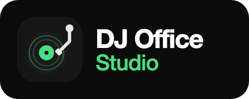
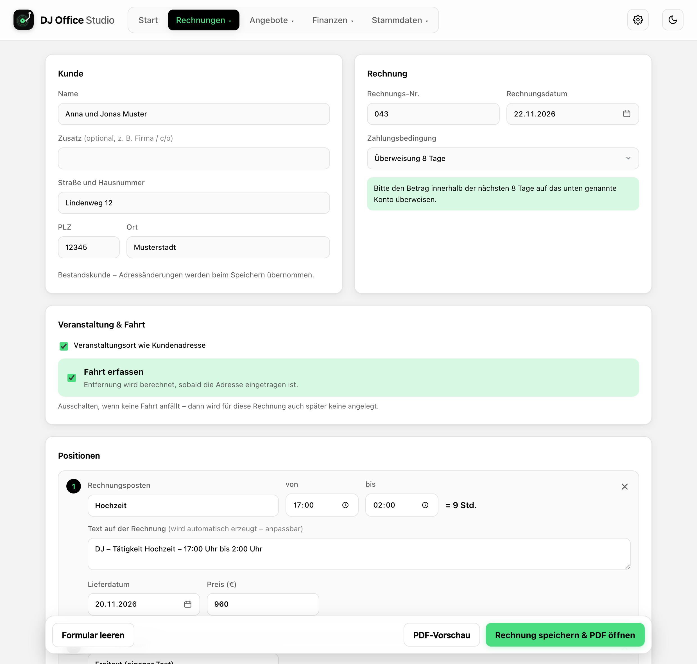
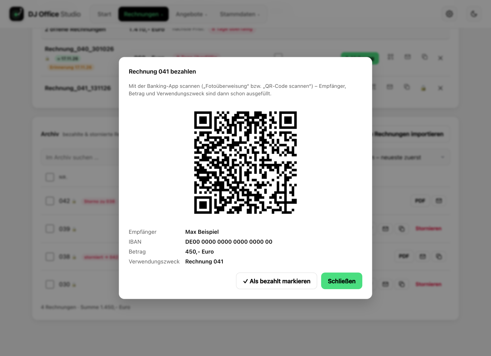
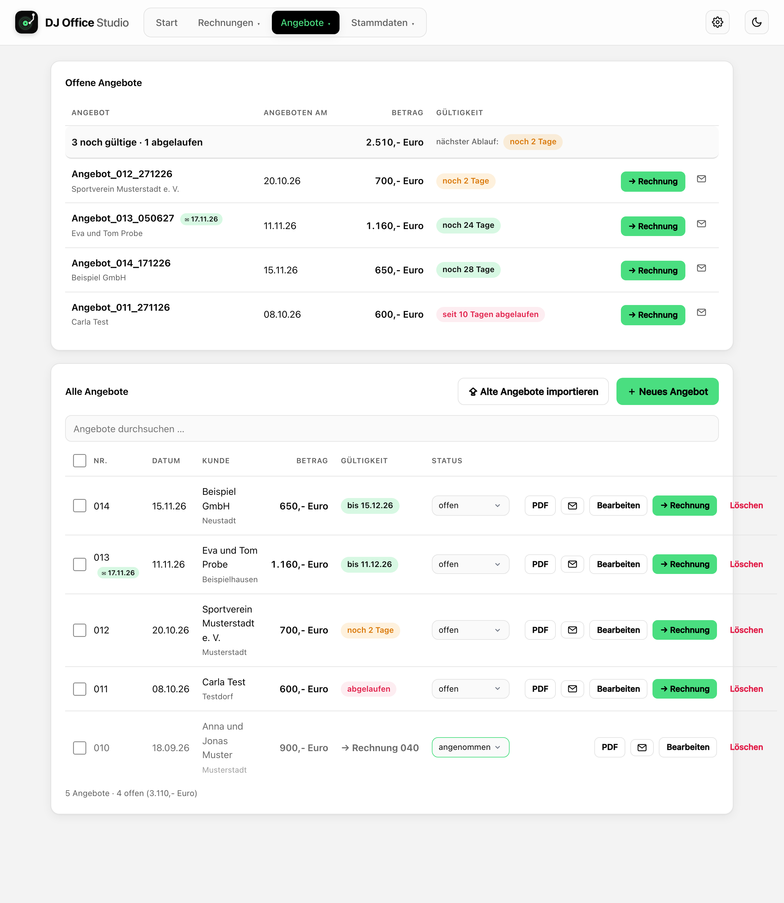
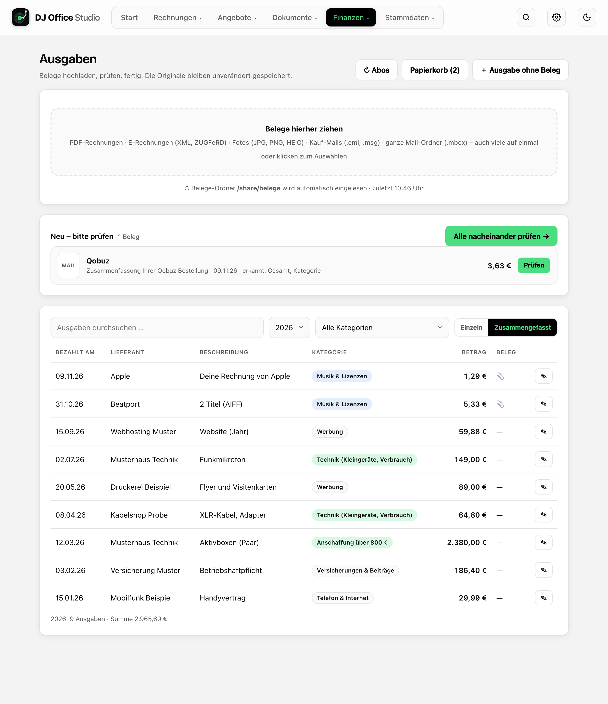
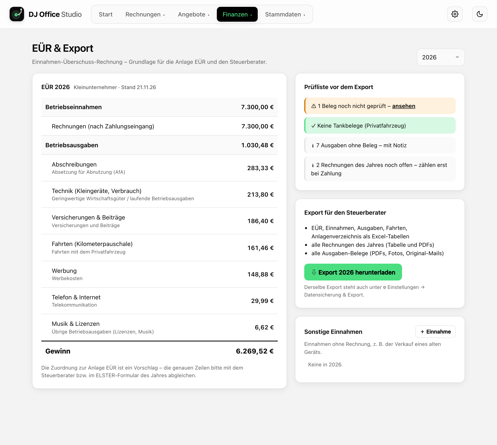

# DJ Office Studio

DJ Office Studio ist eine App zum Schreiben von DJ-Rechnungen und -Angeboten – als App für Home Assistant oder eigenständig unter Windows und macOS. Kunden auswählen, Rechnungsposten und Uhrzeiten eintragen, Preis festlegen – fertig ist das PDF. Dazu kommen die **Finanzen**: Ausgaben mit Belegen, gefahrene Kilometer, Abschreibungen und eine Einnahmen-Überschuss-Rechnung (EÜR) mit Export für den Steuerberater.



## Funktionen

- **Startseite** mit Kacheln für alle Aktionen der App und dem aktuellen Stand: offene Rechnungen mit Restzeit und Warnung bei Überfälligkeit, offene Angebote mit Restlaufzeit, Gewinn des laufenden Jahres, Zeit seit der letzten Datensicherung, Umsatz nach Monat/Jahr und die letzten Rechnungen.
- **Rechnungseditor**
  - Kunde mit Autovervollständigung aus bisherigen Kunden; neue Kunden werden beim Speichern automatisch angelegt
  - Positionen per **Rechnungsposten** (Hochzeit, Geburtstag, Firmenfeier, …) mit **von/bis-Zeiten** – der Rechnungstext wird daraus erzeugt, z. B. „DJ – Tätigkeit Hochzeit – 17:00 Uhr bis 2:00 Uhr“
  - Freitext-Positionen für alles andere (z. B. Fahrtkosten)
  - Preis wird pro Position individuell eingetragen
  - Auswählbare Zahlungsbedingungen (Überweisung 8/14 Tage, bar erhalten, …)
  - Fortlaufende Rechnungsnummer (dreistellig, Startwert einstellbar)
  - Prüft die Pflichtangaben einer Rechnung (vollständige Anschrift des Kunden, Lieferdatum je Position)
- **PDF** im A4-Layout mit Absenderzeile, Adressfeld, Positionstabelle, QR-Code zum Bezahlen und Fußzeile (Bankverbindung, Steuernummer, Kleinunternehmer-Hinweis nach § 19 UStG bzw. Umsatzsteuer). Vorschau vor dem Speichern; beim Speichern wird eine Kopie im PDF-Ordner abgelegt (Home Assistant: `/share/rechnungen`, Desktop: `Dokumente/DJ Office Studio/PDFs`).
- **Offene Rechnungen** auf einen Blick: eine Summenzeile mit Anzahl, Gesamtbetrag und nächster Frist; darunter je Rechnung Rechnungsname (z. B. `Rechnung_037_311026`), Betrag, verbleibende Zeit („noch 5 Tage“, „3 Tage überfällig“), ein Haken zum Abhaken, wenn bezahlt wurde, und Buttons für **Zahlungserinnerung / Mahnung**, QR-Code zum Bezahlen, Senden per E-Mail, Kopieren, Festschreiben (🔒) und Löschen bzw. Stornieren (✕). Das Zahlungsziel wird aus der Zahlungsbedingung gelesen (z. B. „innerhalb der nächsten 8 Tage“) und ab dem Rechnungsdatum gerechnet.
- **Archiv** für bezahlte und stornierte Rechnungen: Wird eine offene Rechnung abgehakt, wandert sie ins Archiv – mit Suche und Sortierung nach Nummer, Datum, Betrag oder Kunde. Bezahlte Rechnungen lassen sich wieder auf „offen“ setzen. Mehrere Rechnungen markieren und **als ZIP herunterladen** oder **an Paperless-ngx senden**.
- **Festschreiben & Storno**: Eine Rechnung lässt sich nur ändern oder löschen, solange sie nicht festgeschrieben ist. Festgeschrieben wird sie automatisch, sobald sie bezahlt, gemahnt oder an Paperless gesendet wird – oder per 🔒 von Hand (z. B. nach dem Versenden). Danach wird korrigiert, wie es steuerlich sein soll: per **Stornorechnung** mit eigener Nummer und negativen Beträgen.
- **Zahlungserinnerung und Mahnungen**: Zu offenen Rechnungen per Klick eine Zahlungserinnerung, dann 1. und 2. Mahnung als PDF – mit Bezug auf die Rechnung, Fälligkeitsdatum und neuer Zahlungsfrist (Standard 7 Tage).
- **E-Mail-Versand**: Rechnungen, Angebote, Zahlungserinnerungen und Mahnungen direkt aus der App per E-Mail verschicken – über das eigene Postfach, egal bei welchem Anbieter (Vorlagen für WEB.DE, GMX, Gmail, iCloud, T-Online & Co., aber auch jeder andere Anbieter oder eigene Mailserver). Empfänger kommt aus den Kundendaten, Betreff und Text aus anpassbaren Vorlagen, das PDF hängt automatisch an. Verschickte Belege tragen einen Vermerk „✉ Datum“, Rechnungen werden dabei festgeschrieben. Herunterladen (z. B. zum Weiterschicken per WhatsApp) geht wie bisher – direkt im selben Dialog.
- **Umsatzsteuer**: Für Kleinunternehmer ohne Umsatzsteuer mit Hinweis nach § 19 UStG. Ohne Kleinunternehmerregelung sind die Positionspreise Nettopreise; Rechnung und Angebot weisen Nettobetrag, Umsatzsteuer (19 % oder 7 %) und Gesamtbetrag aus, der Export enthält Netto, Steuersatz und Steuer. Die Steuer wird je Beleg gespeichert – ein späterer Wechsel in den Einstellungen ändert bereits geschriebene Rechnungen nicht.
- **Kopieren**: Eine Rechnung oder ein Angebot mit einem Klick als neuen Beleg übernehmen (Kunde, Texte, Preise, Zahlungsbedingung) – praktisch für Stammkunden und jährlich wiederkehrende Feiern. Neue Nummer, heutiges Datum, das Datum der Veranstaltung trägt man neu ein.
- **QR-Code zum Bezahlen (GiroCode)**: Auf Rechnungen, Zahlungserinnerungen und Mahnungen steht neben der Zahlungsbedingung ein QR-Code. Der Kunde scannt ihn mit seiner Banking-App, und Empfänger, IBAN, Betrag und Verwendungszweck („Rechnung 037“) sind schon ausgefüllt. Bei offenen Rechnungen zeigt die App den Code auch groß auf dem Bildschirm an, z. B. wenn direkt nach der Feier bezahlt wird. Nicht auf Angeboten, Stornorechnungen und bei „Bar erhalten“ / „Bereits bezahlt“; abschaltbar unter ⚙ Einstellungen.
- **Datensicherung & Export**: Unter ⚙ Einstellungen alle Daten samt Ausgaben-Belegen als eine Sicherungsdatei herunterladen bzw. wieder einspielen. Die Startseite zeigt, wie lange die letzte Sicherung her ist, und erinnert nach einstellbarer Zeit (Standard 30 Tage) an eine neue. Dazu ein **Export für den Steuerberater**: alle Rechnungen eines Jahres als Excel-Tabelle (CSV, mit Bezahlt-Datum, Stornos und ggf. Umsatzsteuer) plus PDFs, dazu EÜR, Ausgaben, Fahrten, Anlagenverzeichnis und alle Belege – als ein ZIP. Die Desktop-Version sichert zusätzlich automatisch einmal pro Tag.
- **Angebote**: Im selben Editor wie Rechnungen (Kunde, Rechnungsposten mit von/bis-Zeiten, Preise) – mit eigenem Nummernkreis, Angebotsdatum, **Gültig bis** (Bindefrist, Standard 30 Tage), optionaler Zahlungsbedingung und freien **Hinweisen** (z. B. Verlängerungsstunde, Leistungsumfang, GEMA). Das PDF hat dasselbe Layout wie die Rechnung (`Angebot_001_120627.pdf`). Oben in der Angebotsansicht und auf der Startseite: **Offene Angebote** mit Angebotsdatum und Restlaufzeit („noch 12 Tage“, „seit 3 Tagen abgelaufen“), auf der Startseite zusätzlich ein Hinweis, wenn ein Angebot in den nächsten 3 Tagen abläuft. In der Angebotsliste: mehrere markieren und als ZIP herunterladen oder an Paperless senden, Status (offen / angenommen / abgelehnt), Restlaufzeit bzw. „abgelaufen“ und **→ Rechnung**, das Kunde und Positionen in eine neue Rechnung übernimmt und das Angebot als angenommen markiert.
- **Import alter Rechnungen und Angebote**: Bisherige PDFs hochladen (gemischt möglich – die App erkennt Rechnung oder Angebot selbst). Empfänger, Positionen und Vorschläge für Rechnungsposten werden erkannt und können übernommen werden, optional auch die Rechnungen selbst als Archiv und die Angebote (mit „gültig bis“ und Hinweisen) in die Angebotsliste.
- **Finanzen**
  - **Ausgaben mit Belegen**: PDF-Rechnungen, Fotos (JPG, PNG, HEIC) und Kauf-Mails (.eml, .msg – z. B. von Beatport, iTunes/Apple, Amazon, Qobuz, Bandcamp) per Drag & Drop hochladen – auch ganze Mail-Ordner (Postfach-Export .mbox) oder Finder-Ordner mit Hunderten Mails auf einmal. Die App liest Lieferant, Datum, Betrag und Umsatzsteuer aus – bei **Fotos und Scans mit Texterkennung, vollständig lokal** – und schlägt eine Kategorie vor; man prüft nur noch und übernimmt. Ein **Belege-Ordner** wird automatisch eingelesen (Home Assistant: `/share/belege`) – praktisch mit Scanner-Apps, Cloud-Ordnern oder Mail-Regeln. Wer **Paperless-ngx** nutzt, lässt die App einfach den Ordner lesen, in dem Paperless die Ausgaben ablegt. Die Originale bleiben unverändert gespeichert, doppelte Belege werden erkannt, Gelöschtes landet im **Papierkorb** und lässt sich wiederherstellen. Ausgaben ohne Beleg (z. B. Parkautomat) gehen mit Notiz. Privatanteil in Prozent (z. B. Handyvertrag).
  - **Fahrten**: Zu jeder Rechnung wird automatisch die Hin- und Rückfahrt zum Veranstaltungsort erfasst – auf Wunsch mit Kilometern von OpenStreetMap, sonst von Hand. Pro Rechnung abwählbar, eigene Fahrten (z. B. zum Musikladen) lassen sich ergänzen. Mit Privatfahrzeug zählt die Kilometerpauschale (Standard 0,30 €/km).
  - **Anschaffungen & Abschreibung**: Geräte über 800 € netto werden über die Nutzungsdauer abgeschrieben (linear, monatsgenau; Computer im Kaufjahr voll). Anlagenverzeichnis mit Restwerten, Übernahme von Geräten aus Vorjahren und Verkauf/Ausscheiden.
  - **Übersicht** mit Einnahmen, Ausgaben und Gewinn des Jahres, Diagramm je Monat (auch als Tabelle) und Ausgaben nach Kategorie.
  - **Kleinunternehmer-Grenzen**: Die Übersicht zeigt, wie viel Umsatz im Jahr schon zusammengekommen ist – gemessen an den 25.000 € (entscheidet, ob man im nächsten Jahr noch Kleinunternehmer ist) und den 100.000 € (darüber sofort umsatzsteuerpflichtig), dazu den Vorjahresumsatz. Wird es knapp – auch mit offenen Rechnungen –, warnen Übersicht, Startseite und Prüfliste.
  - **EÜR & Export**: Einnahmen-Überschuss-Rechnung nach Zahlungseingang und -ausgang mit Vorschlag für die Zeilen der Anlage EÜR, Prüfliste vor dem Export (ungeprüfte Belege, fehlende Bezahlt-Daten, fehlende Kilometer …) und ein ZIP für den Steuerberater mit allen Tabellen, Rechnungen und Belegen. Sonstige Einnahmen ohne Rechnung (z. B. Verkauf eines alten Geräts) lassen sich ergänzen.
- **Stammdaten** für Kunden, Rechnungsposten und Zahlungsbedingungen.
- Helles und dunkles Design (folgt der Geräteeinstellung, umschaltbar oben rechts), nutzbar am Computer, Tablet und Handy.

## Bedienung

Oben in der Kopfzeile gibt es auf jeder Seite das Menü: **Start**, **Rechnungen** (Neue Rechnung, Rechnungen), **Angebote** (Neues Angebot, Angebote), **Finanzen** (Übersicht, Ausgaben, Fahrten, Anschaffungen, EÜR & Export) und **Stammdaten** (Kunden, Rechnungsposten, Zahlungsbedingungen).


**Start:** Die Startseite öffnet sich beim Aufruf. Über das Menü oder die Kacheln geht es direkt zu jedem Bereich der App (inkl. Import alter Rechnungen und Angebote). Ein Klick auf das Logo führt zurück zur Startseite. Darunter steht der aktuelle Stand: offene Rechnungen mit Restzeit, offene Angebote mit Restlaufzeit, die Zeit seit der letzten Datensicherung (mit **Jetzt sichern**), Umsatz und die letzten Rechnungen – plus Hinweise bei überfälligen Rechnungen und bald ablaufenden Angeboten.


**Neue Rechnung:** Kundennamen eintippen und einen Vorschlag übernehmen (oder neue Adresse eingeben). Pro Position einen Rechnungsposten wählen, von/bis eintragen, Lieferdatum und Preis ergänzen. Zahlungsbedingung wählen, dann **PDF-Vorschau** oder **Rechnung speichern & PDF öffnen**. Gespeichert wird eine Rechnung nur mit den Pflichtangaben: vollständige Anschrift des Kunden (Straße, PLZ, Ort) und ein Lieferdatum bei jeder Position. Die PDF-Vorschau geht auch ohne, Angebote sind davon ausgenommen. Mit dem Kopieren-Symbol bei einer Rechnung oder einem Angebot startet man einen neuen Beleg mit denselben Angaben.

**Datum eingeben:** Alle Datumsfelder nehmen das Datum einfach getippt an – `7.10.2019`, `07.10.19` oder `07102019`; ohne Jahr (`7.10.`) gilt das aktuelle Jahr. Das Kalender-Symbol im Feld öffnet einen Kalender.

**Rechnungen:** Oben die offenen Rechnungen mit Restzeit. Ist eine Rechnung bezahlt, Haken setzen – sie wandert ins Archiv. Bei überfälligen Rechnungen erzeugt der grüne Button die nächste Stufe (Zahlungserinnerung → 1. Mahnung → 2. Mahnung) als PDF. 🔒 schreibt eine Rechnung fest, ✕ löscht sie bzw. storniert sie, wenn sie schon festgeschrieben ist. Im Archiv stehen bezahlte und stornierte Rechnungen; dort lassen sich Rechnungen auch stornieren.


**Versenden:** Der Briefumschlag an jeder Rechnung und jedem Angebot (auch im Editor nach dem Speichern: **Senden**) öffnet den Versand-Dialog. Empfänger, Betreff und Text sind vorausgefüllt und lassen sich ändern; bei einer Rechnung mit Mahnung wird standardmäßig die letzte Mahnung samt Rechnung verschickt. Fehlt beim Kunden noch die E-Mail-Adresse, kann sie direkt mitgespeichert werden. Wer lieber per WhatsApp oder Messenger schickt, lädt das PDF unten im Dialog herunter (auf dem Handy bzw. über HTTPS gibt es zusätzlich **Teilen …**).


**QR-Code zum Bezahlen:** Das QR-Symbol bei einer offenen Rechnung zeigt den GiroCode groß an – der Kunde scannt ihn mit seiner Banking-App („Fotoüberweisung“ bzw. „QR-Code scannen“). Mit **Als bezahlt markieren** wandert die Rechnung danach direkt ins Archiv. Derselbe Code ist auch auf dem Rechnungs-PDF gedruckt.



**Angebote:** Über **Angebote → Neues Angebot** im selben Editor schreiben – zusätzlich mit **Gültig bis** und freien **Hinweisen** (z. B. Verlängerungsstunde, GEMA). In **Angebote → Angebote** stehen oben die offenen Angebote mit Restlaufzeit, darunter alle Angebote mit Status (offen / angenommen / abgelehnt). **→ Rechnung** macht aus einem Angebot eine neue Rechnung und markiert es als angenommen.



**Rechnungsposten:** Unter **Stammdaten → Rechnungsposten** neue Rechnungsposten (z. B. Hochzeit) anlegen. Ohne eigene Text-Vorlage wird `DJ – Tätigkeit <Bezeichnung> – {von} Uhr bis {bis} Uhr` verwendet; `{von}` und `{bis}` werden durch die Uhrzeiten ersetzt.

**Alte Rechnungen und Angebote importieren:** Unter **Rechnungen** (Archiv) auf **Alte Rechnungen importieren** bzw. unter **Angebote** auf **Alte Angebote importieren** klicken und PDFs hineinziehen – gemischt möglich. Danach auswählen, welche Empfänger, Rechnungsposten, Rechnungen und Angebote übernommen werden. Erkannt werden PDFs mit echtem Text, die so aufgebaut sind wie die PDFs der App (Absenderzeile mit „|“, Adresse, „Rechnung Nr.“ bzw. „Angebot“, Tabelle, „Gesamt“). Eingescannte Dokumente werden nicht unterstützt.

### Finanzen

**Jahr wählen:** Die Jahresmenüs reichen vom ältesten Eintrag bis heute.

**Übersicht:** Einnahmen, Ausgaben und Gewinn des gewählten Jahres – so gerechnet wie in der EÜR: Einnahmen zählen am Tag des Zahlungseingangs, Ausgaben am Tag der Bezahlung. Für Kleinunternehmer folgt die Karte **Kleinunternehmer-Grenzen** (Umsatz nach Zahlungseingang gegenüber 25.000 € und 100.000 €, Vorjahresumsatz, offene Rechnungen, grobe Hochrechnung) mit Warnungen, wenn es eng wird. Darunter Hinweise auf offene Punkte, das Diagramm je Monat (Maus darüber zeigt die Werte, **Als Tabelle** zeigt alle Zahlen) und die Ausgaben nach Kategorie. Die Abschreibung steht als Jahresbetrag im Dezember.


**Texterkennung für Fotos und Scans:** Fotos (auch HEIC, schief, quer oder auf dem Kopf) und PDFs ohne Text liest die App im Hintergrund, einen nach dem anderen – in der Liste steht solange „Text wird gelesen …“. Man kann den Beleg währenddessen schon öffnen und ausfüllen; eigene Eingaben werden nie überschrieben. Danach sind Lieferant, Datum, Betrag und – wenn er rechnerisch passt – der Umsatzsteuersatz vorgeschlagen. Gibt es keine Summenzeile, weist die App darauf hin. **Immer mit dem Beleg vergleichen:** Texterkennung kann sich verlesen, Handschrift und stark verblasste Bons liest sie oft nicht. Bei PDFs werden die ersten drei Seiten gelesen. Mit **Text erkennen** lässt sich ein Beleg ohne Betrag erneut lesen.

Die Erkennung läuft vollständig auf dem eigenen Gerät und ohne Netzwerk. Sie braucht kurzzeitig etwa 300–600 MB freien Arbeitsspeicher und auf einem Mac mindestens macOS 13; wo sie nicht läuft, trägt man die Werte von Hand ein.

**Ausgaben:** Belege in das Feld ziehen – PDFs, Fotos oder Kauf-Mails als .eml/.msg. **Apple Mail** gibt Mails beim Ziehen nicht direkt an den Browser weiter – entweder die Mails erst auf den Schreibtisch bzw. in einen Finder-Ordner ziehen und von dort in die App, oder einen ganzen Mail-Ordner auf einmal: Ordner anklicken → **Postfach → Postfach exportieren …** → den entstandenen Ordner „….mbox“ in die App ziehen. Thunderbird-Ordner (mbox-Dateien) gehen genauso; doppelte Mails werden erkannt. Neue Belege stehen unter **Neu – bitte prüfen**. **Alle nacheinander prüfen** öffnet sie der Reihe nach: links der Beleg, rechts die erkannten Angaben. Wo der Betrag gefunden wurde, steht darunter („erkannt: Gesamt … 3,63 €“). Kurz vergleichen, ggf. korrigieren, **Übernehmen**. Erst übernommene Ausgaben zählen in der EÜR. Viele kleine Musikkäufe lassen sich in der Liste je Monat und Shop **zusammengefasst** anzeigen.




**Papierkorb:** **Verwerfen** (ungeprüfter Beleg) und **Löschen** (übernommene Ausgabe) legen den Eintrag samt Beleg in den Papierkorb (Finanzen → Ausgaben → **Papierkorb**). Was dort liegt, zählt nicht in EÜR, Übersicht, Abschreibung und Export.

- **Wiederherstellen** bringt den Eintrag so zurück, wie er war – eine Anschaffung samt eingestellter Nutzungsdauer. Gibt es schon eine Ausgabe mit gleichem Betrag und Datum, fragt die App vorher nach.
- Wird derselbe Beleg noch einmal hochgeladen oder in den Belege-Ordner gelegt, bietet die App das Wiederherstellen an.
- Aus Paperless kommt Verworfenes nicht von selbst zurück, auch nicht nach dem endgültigen Löschen. Von Hand hochladen geht immer.
- Geleert wird nur von Hand. **Endgültig löschen** entfernt die Belegdatei aus der App – Buchungsbelege muss man in der Regel 8 Jahre aufbewahren. Dateien in Paperless bleiben immer unberührt.
- Beim Update auf 1.6 legt die App einmalig in den Papierkorb, was früher aus dem Belege-Ordner verworfen wurde und dort noch liegt. Früher verworfene Uploads gibt es nur noch in älteren Sicherungen.


**Fahrten:** Im Rechnungseditor gibt es die Karte **Veranstaltung & Fahrt** (Veranstaltungsort, Standard: Adresse des Kunden) und den Schalter **Fahrt erfassen**. Beim Speichern der Rechnung legt die App die Fahrt an; ist unter ⚙ Einstellungen → Fahrten der Kartendienst eingeschaltet, berechnet sie die Strecke über OpenStreetMap. Dafür werden Startadresse und Veranstaltungsort an die öffentlichen Dienste von OpenStreetMap (Nominatim, OSRM) geschickt – sonst nichts; ausgeschaltet trägt man die Kilometer selbst ein. Kilometer lassen sich in der Liste korrigieren („korrigiert“), Fahrten ohne Rechnung über **Fahrt ergänzen** hinzufügen. Mit Betriebsfahrzeug zählen statt der Pauschale die echten Kosten (Tanken, Werkstatt …) als Ausgaben.


**Anschaffungen:** Wird eine Ausgabe als „Anschaffung über 800 €“ eingeordnet, landet das Gerät automatisch im Anlagenverzeichnis und wird abgeschrieben (Nutzungsdauer vorgeschlagen, änderbar). Geräte aus früheren Jahren übernimmt man mit **Gerät aus Vorjahren übernehmen** und dem Restwert zum 1.1. Wird ein Gerät verkauft oder entsorgt, trägt man das Datum und ggf. den Erlös ein.

**EÜR & Export:** Die EÜR des Jahres mit allen Einnahmen- und Ausgabenposten und dem Gewinn. Die Prüfliste daneben zeigt, was vor dem Export noch fehlt – z. B. ungeprüfte Belege oder bezahlte Rechnungen ohne Bezahlt-Datum (alte Importe; unter **nachtragen** mit einem Klick das Rechnungsdatum übernehmen oder einzeln eintragen). **Export herunterladen** erzeugt das ZIP für den Steuerberater. Die Zuordnung zu den Zeilen der Anlage EÜR ist ein Vorschlag – bitte mit dem Steuerberater abgleichen.



## Einstellungen

Alle Einstellungen werden **in der App** gemacht: oben rechts auf **⚙** klicken.


| Bereich | Felder |
|---|---|
| Absender | Name (Absender, Gruß, Kontoinhaber), Straße, PLZ und Ort, Telefon, Ort vor dem Datum („Musterstadt, den …“) |
| Bankverbindung | Bank, abweichender Kontoinhaber, IBAN, BIC, QR-Code zum Bezahlen (GiroCode) drucken |
| Steuer | Steuernummer, Kleinunternehmer (§ 19 UStG) – Hinweis auf die Steuerbefreiung (ab Belegdatum 18.11.2026: „Steuerbefreiung nach § 19 UStG (Kleinunternehmerregelung)“, ältere Belege behalten ihre ursprüngliche Formulierung); ohne Kleinunternehmerregelung: Umsatzsteuersatz (19 % / 7 %) und optional USt-IdNr. |
| Nummern & Fristen | Rechnungen ab Nr., Angebote ab Nr. (danach wird automatisch hochgezählt), Gültigkeit neuer Angebote in Tagen |
| Ablage & Paperless | Ordner für PDF-Kopien (Standard `/share/rechnungen`), **Belege-Ordner** (Standard `/share/belege`, wird automatisch eingelesen) mit „Eingelesene Dateien verschieben“, „Paperless-ngx ist installiert“, Paperless-Eingangsordner; **Belege aus Paperless** |
| Fahrten | Fahrzeug (Privatfahrzeug mit Kilometerpauschale / Betriebsfahrzeug), Kilometersatz, Startadresse (Standard: eigene Adresse), Kartendienst OpenStreetMap ein/aus, „Fahrt erfassen“ bei neuen Rechnungen |
| E-Mail-Versand | eigene E-Mail-Adresse, Anbieter-Vorlage, Postausgangsserver (SMTP), Port, Verschlüsselung, Benutzername, Passwort, „Antworten an“, Kopie an mich, Textvorlagen für Rechnung / Angebot / Mahnung |

Unten auf der Seite steht außerdem die installierte Version mit Link zum Changelog.

Die Angaben erscheinen in Absenderzeile, Gruß und Fußzeile jeder Rechnung und jedes Angebots. Fehlen Angaben für vollständige Rechnungen – Name, Straße, PLZ und Ort, IBAN und ohne Kleinunternehmerregelung die Steuernummer oder USt-IdNr. –, zeigt die App oben einen Hinweis, was fehlt, mit Link zu den Einstellungen.

> **Umstieg von älteren Versionen:** Bis Version 0.8 wurden diese Werte in Home Assistant unter *Einstellungen → Apps → DJ Office Studio → Konfiguration* eingetragen. Version 0.9.0 übernimmt sie beim ersten Öffnen der App automatisch in die eigenen Einstellungen; ab 0.9.1 gibt es die Felder in Home Assistant nicht mehr. Wer direkt von 0.8 oder älter auf 0.9.1 oder neuer aktualisiert, trägt die Werte einmal unter ⚙ neu ein.

### E-Mail-Versand

Die App verschickt über den **Postausgangsserver (SMTP) deines eigenen Postfachs** – das funktioniert mit jedem Anbieter. Unter ⚙ Einstellungen → E-Mail-Versand die eigene Adresse eintragen: Bei bekannten Anbietern werden Server, Port und Verschlüsselung automatisch vorgeschlagen, alles andere (eigene Domain, Webhoster, eigener Server) wird von Hand eingetragen. Mit **Testmail an mich senden** lässt sich die Einrichtung vor dem Speichern prüfen.

- **Freischalten / App-Passwort:** Bei WEB.DE, GMX und freenet muss der Zugriff über externe Programme (POP3/IMAP/SMTP) erst im Postfach erlaubt werden. Gmail, iCloud und Yahoo brauchen ein eigenes **App-Passwort** statt des normalen Passworts, T-Online das separate E-Mail-Passwort. Die App zeigt den passenden Hinweis beim gewählten Anbieter an.
- **Gesendet-Ordner:** Per SMTP verschickte Mails landen nicht automatisch im „Gesendet“-Ordner des Postfachs. Deshalb gibt es die Option **Kopie an mich** (BCC) – dann liegt jede verschickte Mail auch im Posteingang.
- **Passwort:** Es wird nur lokal in der Datenbank der App gespeichert, nie an die Oberfläche zurückgegeben und ist **nicht** in der herunterladbaren Sicherung enthalten. Nach dem Einspielen einer Sicherung auf einem anderen Gerät einmal neu eintragen.
- **Textvorlagen:** Betreff und Text für Rechnung, Angebot und Mahnung sind frei änderbar, mit Platzhaltern wie `{kunde}`, `{nummer}`, `{betrag}`, `{faellig}`, `{gueltig_bis}`, `{stufe}`, `{frist}`. Eine Zeile, deren Platzhalter leer bleibt (z. B. Rechnung ohne Zahlungsfrist), entfällt automatisch.

### Paperless-ngx

Ist unter ⚙ Einstellungen „Paperless-ngx ist installiert“ eingeschaltet, gibt es im Archiv bei markierten Rechnungen und in der Angebotsliste bei markierten Angeboten den Button **⇪ An Paperless senden** (sonst ist er ausgeblendet). Jede Rechnung wird als komplette PDF-Datei (z. B. `Rechnung_037_311026.pdf`) in den Eingangsordner von Paperless gelegt – Titel, Korrespondent, Dokumenttyp, Tags usw. vergibt Paperless anschließend selbst (z. B. über Zuweisungsregeln oder die automatische Zuordnung). Übertragene Rechnungen sind im Archiv mit „Paperless ✓“ gekennzeichnet; ein Klick darauf setzt die Markierung zurück (z. B. wenn das Dokument in Paperless gelöscht wurde).

- Der Paperless-Eingangsordner muss auf den Eingangsordner (consume) der Paperless-App zeigen – welcher das ist, steht in der Konfiguration der Paperless-App. In Home Assistant muss der Ordner unter `/share` oder `/media` liegen, damit DJ Office Studio darauf zugreifen kann; in der Desktop-Version geht jeder erreichbare Ordner (z. B. ein Netzlaufwerk).
- Existiert der Ordner nicht, meldet die App einen Fehler, statt ihn anzulegen – so landen keine PDFs unbemerkt im falschen Ordner.

**Ausgaben-Belege aus Paperless** (Finanzen → Ausgaben) – erscheint nur, wenn „Paperless-ngx ist installiert“ angehakt ist:

- **Am einfachsten – Ablage lesen:** Legt Paperless die Ausgaben per Speicherpfad in einem eigenen Ordner ab (z. B. `DJ/{{ created_year }}/Ausgaben/…`), klickt man auf **Ausgaben-Ordner von Paperless suchen**. Die App sucht in `/share` und `/media` nach dem Ordner „Ausgaben“ in der Ablage von Paperless (`…/documents/originals/…`), trägt ihn als Belege-Ordner ein – mit `*` für alle Jahre, z. B. `…/originals/DJ/*/Ausgaben` – und liest ihn ab dann automatisch. Die Dateien bleiben unverändert liegen (nur lesen), neue Belege kommen von selbst dazu. Voraussetzung: Die Ablage von Paperless liegt unter `/share` oder `/media` (Einstellung des Paperless-Add-ons).
- **Alternativ – über die Schnittstelle:** Liegen die Belege nicht in einem eigenen Ordner, holt **⇩ Aus Paperless abholen** alle Dokumente mit einem Tag. Einrichten:

1. **Paperless-Benutzername und -Passwort** eintragen (dieselbe Anmeldung wie in Paperless) und **Mit Paperless verbinden** klicken. Die App findet das Paperless-Add-on in Home Assistant selbst, holt sich einen Zugangsschlüssel (API-Token) und speichert das Passwort nicht.
2. Den **Tag der Ausgaben-Belege** wählen – heißt ein Tag z. B. „Ausgaben“ oder „Belege“, ist er schon vorausgewählt. Die Auswahl wird sofort gespeichert.

Unter *Erweitert* lassen sich Adresse und API-Token auch von Hand eintragen – nötig für die **Desktop-Version** (Adresse im Heimnetz, z. B. `http://homeassistant.local:8000`; dafür muss das Add-on seinen Port freigeben) oder wenn Paperless nicht als Add-on läuft. In Home Assistant fragt die App dafür den Supervisor nach den installierten Add-ons (Berechtigung `hassio_api`, nur lesend).

**Belege-Ordner allgemein:** Was im Belege-Ordner landet, liest die App jede Minute und beim Öffnen der Ausgaben ein; erkannte Belege erscheinen unter „Neu – bitte prüfen“. Ist „Eingelesene Dateien verschieben“ an (Standard), wandern sie danach in den Unterordner `übernommen` (unlesbare nach `nicht lesbar`); aus = nur lesen, die App merkt sich, was sie schon kennt. Dateien, die gerade noch geschrieben werden, wartet sie kurz ab. Doppelte Belege werden erkannt.

Beim Abholen über die Schnittstelle kommen alle Dokumente mit dem Tag – auch aus früheren Jahren –, die noch nicht übernommen sind. Die App speichert eine Kopie (die PDF mit Texterkennung aus Paperless), damit Export und Sicherung auch ohne laufendes Paperless funktionieren. Lieferant (Korrespondent) und Datum kommen aus Paperless, der Betrag wird aus dem Text gelesen; die Belege stehen dann unter **Neu – bitte prüfen**. Wurde ein Beleg schon von Hand hochgeladen, wird er nur verknüpft und nicht doppelt angelegt. In Paperless wird nichts verändert. Der API-Token wird wie das E-Mail-Passwort nur lokal gespeichert und ist nicht in der Sicherung enthalten.

## Installation

DJ Office Studio läuft entweder als App in Home Assistant oder eigenständig unter Windows und macOS – Funktionen und Oberfläche sind gleich.

### In Home Assistant

1. In Home Assistant **Einstellungen → Apps → App-Store** öffnen.
2. Oben rechts **⋮ → Repositories** wählen und diese URL hinzufügen:
   ```
   https://github.com/DJMalte96/dj-office-studio
   ```
3. **DJ Office Studio** im App-Store auswählen und **Installieren**. Beim ersten Mal wird das Image gebaut – das dauert ein paar Minuten.
4. **Starten** und „In Seitenleiste anzeigen“ aktivieren.
5. In der App oben rechts auf **⚙** klicken und Absenderdaten, Bankverbindung usw. eintragen (siehe [Einstellungen](#einstellungen)).

> Das Repository hieß früher `ha-rechnungen`. Wer es unter der alten Adresse schon in Home Assistant eingetragen hat, lässt es einfach so – GitHub leitet weiter, Updates kommen weiterhin an. Bitte **nicht** entfernen und neu hinzufügen: Home Assistant würde die App sonst als neue App behandeln.

### Ohne Home Assistant (Windows / Mac)

DJ Office Studio gibt es auch als eigenständige App für **Windows** und **macOS** – ohne Home Assistant, ohne Python, ohne Docker. Funktionen und Oberfläche sind dieselben.

**Herunterladen:** Auf der GitHub-Seite unter **Releases** die passende ZIP-Datei laden:

| System | Datei |
|---|---|
| Windows 10/11 | `DJ-Office-Studio-…-Windows.zip` |
| Mac mit Apple-Chip (M1 und neuer) | `DJ-Office-Studio-…-macOS-AppleSilicon.zip` |
| Mac mit Intel-Prozessor | `DJ-Office-Studio-…-macOS-Intel.zip` |

**Windows:** ZIP entpacken (Rechtsklick → *Alle extrahieren*), im Ordner `DJ Office Studio` die Datei **DJ Office Studio.exe** starten. Beim ersten Start warnt Windows ggf. („Der Computer wurde durch Windows geschützt“) – auf **Weitere Informationen → Trotzdem ausführen** klicken. Die App ist nicht kostenpflichtig signiert, daher die Warnung.

**Mac:** ZIP per Doppelklick entpacken und **DJ Office Studio** in den Ordner *Programme* ziehen. Beim ersten Öffnen meldet macOS „*DJ Office Studio* nicht geöffnet – Apple konnte nicht überprüfen, ob … frei von Schadsoftware ist“. Das liegt nur daran, dass die App nicht bei Apple notarisiert ist (kostenpflichtiger Entwickler-Account). So geht es einmalig trotzdem:

1. **Fertig** klicken – *nicht* „In den Papierkorb legen“.
2. *Systemeinstellungen → Datenschutz & Sicherheit* öffnen und ganz nach unten scrollen.
3. Bei „DJ Office Studio wurde blockiert …“ auf **Dennoch öffnen** klicken und mit Passwort/Touch ID bestätigen.

Alternativ im Terminal: `xattr -dr com.apple.quarantine "/Applications/DJ Office Studio.app"` – danach startet die App normal.

**Benutzung:** DJ Office Studio öffnet sich in einem **eigenen Programmfenster** – ohne Browser. Fenster schließen beendet die App. PDFs (Vorschau, Rechnungen, Mahnungen) öffnen sich im PDF-Programm des Computers, Sicherungen und Exporte werden über „Speichern unter“ abgelegt, und unter ⚙ Einstellungen öffnet **Daten- und PDF-Ordner öffnen** den Speicherort. Alles Weitere – Absender, Bankverbindung usw. – unter **⚙ Einstellungen**. Unter Windows nutzt das Fenster Microsoft Edge WebView2 (bei Windows 10/11 vorhanden); fehlt es, öffnet sich die App wie früher im Browser mit einem kleinen Statusfenster.

**Daten:** Alles liegt im Dokumente-Ordner unter `DJ Office Studio` – `Daten` (Datenbank mit Kunden, Rechnungen, Angeboten, Einstellungen) und `PDFs` (Kopien aller Rechnungen und Angebote). Für ein Backup einfach diesen Ordner sichern. Die App ist nur auf dem eigenen Rechner erreichbar.

**Update:** Die App prüft beim Start, ob es eine neue Version gibt, und zeigt dann oben einen Hinweis mit Download-Link (abschaltbar unter ⚙ Einstellungen). Neue ZIP herunterladen und die alte App ersetzen – die Daten im Dokumente-Ordner bleiben erhalten.

## Daten & Backup

| Was | Wo |
|---|---|
| Kunden, Rechnungsposten, Zahlungsbedingungen, Rechnungen, Angebote, Einstellungen | SQLite-Datenbank `rechnungen.db` im App-Datenordner (`/data`) |
| Ausgaben-Belege (Originale) | Ordner `belege/` im App-Datenordner, sortiert nach Jahr |
| PDF-Kopien | Ordner aus den Einstellungen, standardmäßig `/share/rechnungen` (z. B. per Samba erreichbar) |

Alles ist in den normalen Home-Assistant-Backups enthalten. Die Startseite zeigt in der Karte **Datensicherung**, wann zuletzt eine Sicherung heruntergeladen wurde, und färbt sich rot, sobald die eingestellte Zeit (⚙ Einstellungen → Datensicherung & Export, Standard 30 Tage, 0 = keine Erinnerung) überschritten ist – mit **Jetzt sichern** direkt daneben. Zusätzlich gibt es unter **⚙ Einstellungen → Datensicherung & Export** eine Sicherung zum Herunterladen und Einspielen – mit Datenbank und allen Belegen (vor dem Einspielen sichert die App den bisherigen Stand automatisch unter `sicherungen/`).

In der **Desktop-Version** liegt alles im Dokumente-Ordner unter `DJ Office Studio`; die App legt dort in `Daten/Sicherungen` einmal pro Tag automatisch eine Kopie der Datenbank ab (die letzten 14 bleiben erhalten).

## Changelog

Alle Änderungen je Version stehen in [rechnungen/CHANGELOG.md](rechnungen/CHANGELOG.md) – Home Assistant zeigt sie auch beim Update an.

## Hinweis und Lizenz

DJ Office Studio ist ein kostenloses Hilfsmittel zum Schreiben von Rechnungen und Angeboten. Die App prüft wichtige Pflichtangaben, garantiert aber nicht, dass jede Rechnung allen steuerlichen und rechtlichen Anforderungen entspricht – das hängt auch von der eigenen Situation ab (z. B. Kleinunternehmer oder umsatzsteuerpflichtig). **Für den Inhalt der Rechnungen ist jeder Nutzer selbst verantwortlich**; im Zweifel bitte den Steuerberater fragen. Die Nutzung erfolgt ohne Gewähr.

Die App zeigt diesen Hinweis beim ersten Start einmal an; danach steht er unter **⚙ Einstellungen → Hinweise & Lizenz**.

DJ Office Studio steht unter der [MIT-Lizenz](LICENSE): Nutzen, Weitergeben und Verändern sind ausdrücklich erlaubt.

Die Texterkennung verwendet [RapidOCR](https://github.com/RapidAI/RapidOCR) (© RapidOCR Authors) mit Modellen aus [PaddleOCR](https://github.com/PaddlePaddle/PaddleOCR) (© Baidu bzw. PaddleOCR Authors), beides unter der Apache-Lizenz 2.0, dazu ONNX Runtime (MIT), OpenCV (Apache 2.0) und PDFium über pypdfium2 (BSD-3-Clause/Apache 2.0).

## Lokale Entwicklung

Voraussetzung: Python 3.10 bis 3.12 (im Container läuft 3.12; die Pakete der Texterkennung gibt es nicht für 3.9).

```bash
cd rechnungen
python3 -m venv .venv && source .venv/bin/activate
pip install -r requirements.txt

mkdir -p /tmp/djos
DATA_DIR=/tmp/djos OPTIONS_PATH=/tmp/djos/options.json python app/main.py
```

Die Oberfläche läuft dann unter <http://localhost:8099>; Absenderdaten usw. unter ⚙ eintragen.

Desktop-Version lokal starten bzw. bauen (Ergebnis in `dist/`):

```bash
pip install -r desktop/requirements.txt       # eigenes App-Fenster (pywebview)
python desktop/start.py                       # aus dem Quellcode starten
pip install pyinstaller pillow && python desktop/build.py   # App bauen (auf dem jeweiligen System)
```

Die fertigen Windows- und Mac-Versionen baut GitHub Actions (`.github/workflows/desktop.yml`); ein Tag `desktop-v…` erzeugt daraus ein Release. Für die PDFs wird eine TTF-Schrift gesucht (im Container Carlito, lokal z. B. Arial); mit `FONT_REGULAR` und `FONT_BOLD` lässt sich ein eigener Pfad setzen.

### Screenshots für die README

Nach jeder sichtbaren Änderung die Bilder in `docs/bilder/` neu erzeugen (nur mit erfundenen Beispieldaten):

```bash
pip install playwright && python -m playwright install chromium
python docs/screenshots.py
```

### Tests

```bash
pip install -r rechnungen/requirements.txt pytest
pytest tests
```

Die Tests laufen auch automatisch bei jedem Push (GitHub Actions, `.github/workflows/tests.yml`) und vor jedem Bau der Desktop-Version.

### Aufbau

```
repository.yaml          Home-Assistant-Repository
LICENSE                  MIT-Lizenz
rechnungen/
  config.yaml            App-Definition (Name, Version)
  icon.png, logo.png     Symbol und Logo für den App-Store in Home Assistant
  CHANGELOG.md           Änderungen je Version
  Dockerfile             Python 3.12 (Debian) + Carlito-Schrift
  app/
    main.py              Flask-App: REST-API und Auslieferung der Oberfläche
    db.py                SQLite-Datenhaltung
    pdf.py               PDF-Erzeugung (fpdf2) inkl. QR-Code zum Bezahlen (segno)
    importer.py          Auslesen alter Rechnungs- und Angebots-PDFs (pypdf)
    mail.py              E-Mail-Versand per SMTP, Textvorlagen
    finanzen.py          Finanzen: Ausgaben, Fahrten, Anschaffungen/Abschreibung, EÜR, Export
    belege.py            Auslesen von Belegen (PDF, Fotos, Kauf-Mails .eml/.msg/.mbox)
    texterkennung.py     Texterkennung für Fotos und Scans (lokal, im eigenen Prozess)
    paperless.py         Abholen von Ausgaben-Belegen aus Paperless-ngx (REST-Schnittstelle, nur lesend)
    strecken.py          Entfernungen über OpenStreetMap (Nominatim, OSRM) mit Zwischenspeicher
    static/              Oberfläche (HTML, CSS, JavaScript)
desktop/
  start.py               Starter der Desktop-Version (Server + eigenes App-Fenster mit pywebview, Daten im Dokumente-Ordner)
  requirements.txt       Zusätzliche Pakete nur für die Desktop-Version (pywebview)
  build.py               Baut die Desktop-App mit PyInstaller
.github/workflows/
  desktop.yml            Baut Windows- und Mac-Version, bei Tag „desktop-v…“ als Release
  tests.yml              Führt bei jedem Push die Tests aus
docs/
  screenshots.py         Erzeugt die README-Screenshots (docs/bilder/) mit Beispieldaten
tests/                   Automatische Tests (pytest): API, PDFs, Pflichtangaben, Umsatzsteuer, QR-Code, Festschreiben/Storno,
                         Mahnungen, E-Mail-Versand, Sicherung, Import, Belege, Fahrten, Abschreibung, EÜR …
```

### Neue Version veröffentlichen

`version` in `rechnungen/config.yaml` erhöhen, einen Eintrag in `rechnungen/CHANGELOG.md` ergänzen, committen und pushen. Home Assistant bietet das Update dann unter **Apps → App-Store → ⋮ → Nach Updates suchen** an. Für die Desktop-Version zusätzlich einen Tag `desktop-v<Version>` pushen – GitHub Actions baut dann die Windows- und Mac-Pakete und veröffentlicht sie als Release.

> Hinweis: Das Basis-Image ist im `Dockerfile` fest vorgegeben. Eine `build.yaml` wird vom Supervisor nicht beachtet – er würde sonst sein Alpine-Image verwenden, in dem `apt-get` fehlt.
