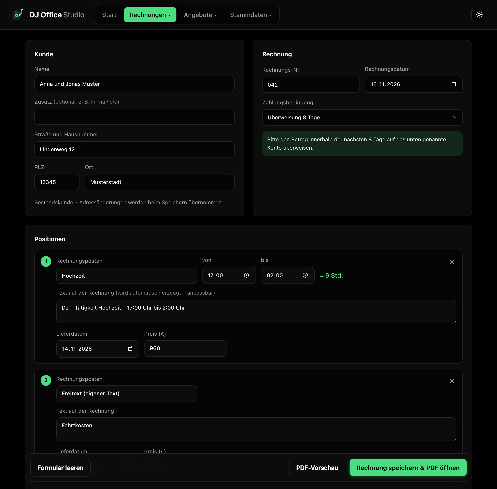
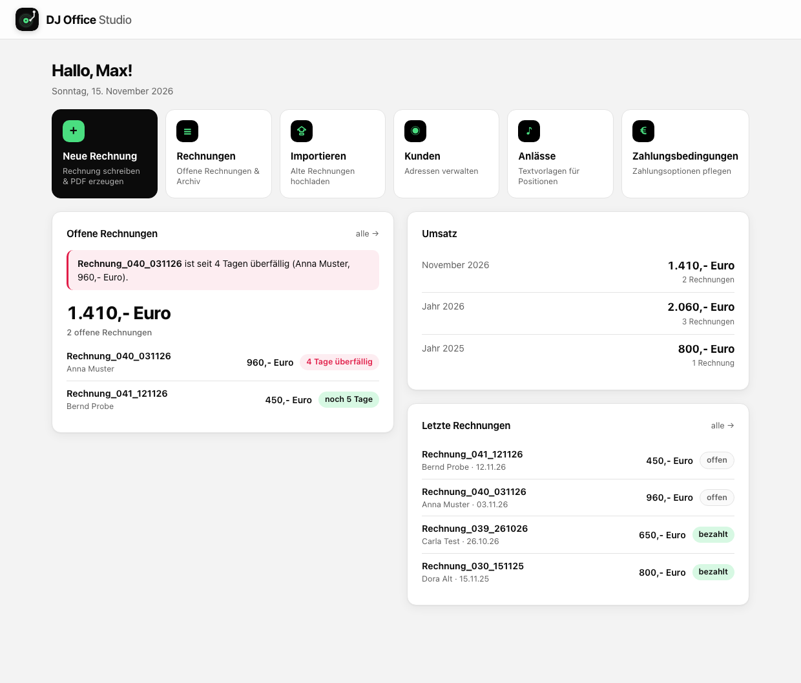

# DJ Office Studio

Eine Home-Assistant-App zum Schreiben von DJ-Rechnungen. Kunden auswählen, Rechnungsposten und Uhrzeiten eintragen, Preis festlegen – fertig ist das PDF im Layout der bisherigen Word-Vorlage.



## Funktionen

- **Startseite** mit Kacheln für alle Aktionen der App und dem Status der Rechnungen: offene Rechnungen mit Restzeit und Warnung bei Überfälligkeit, Umsatz nach Monat/Jahr und die letzten Rechnungen.
- **Rechnungseditor**
  - Kunde mit Autovervollständigung aus bisherigen Kunden; neue Kunden werden beim Speichern automatisch angelegt
  - Positionen per **Rechnungsposten** (Hochzeit, Geburtstag, Firmenfeier, …) mit **von/bis-Zeiten** – der Rechnungstext wird daraus erzeugt, z. B. „DJ – Tätigkeit Hochzeit – 17:00 Uhr bis 2:00 Uhr“
  - Freitext-Positionen für alles andere (z. B. Fahrtkosten)
  - Preis wird pro Position individuell eingetragen
  - Auswählbare Zahlungsbedingungen (Überweisung 8/14 Tage, bar erhalten, …)
  - Fortlaufende Rechnungsnummer (dreistellig, Startwert einstellbar)
- **PDF** im A4-Layout mit Absenderzeile, Adressfeld, Positionstabelle und Fußzeile (Bankverbindung, Steuernummer, Kleinunternehmer-Hinweis nach §19 UStG). Vorschau vor dem Speichern; beim Speichern wird eine Kopie im Ordner `/share/rechnungen` abgelegt.
- **Offene Rechnungen** auf einen Blick: eine Summenzeile mit Anzahl, Gesamtbetrag und nächster Frist; darunter je Rechnung Rechnungsname (z. B. `Rechnung_037_311026`), Betrag, verbleibende Zeit („noch 5 Tage“, „3 Tage überfällig“) , ein Haken zum Abhaken, wenn bezahlt wurde, und ein ✕ zum direkten Löschen. Das Zahlungsziel wird aus der Zahlungsbedingung gelesen (z. B. „innerhalb der nächsten 8 Tage“) und ab dem Rechnungsdatum gerechnet.
- **Archiv** für bezahlte Rechnungen: Wird eine offene Rechnung abgehakt, wandert sie ins Archiv – mit Suche und Sortierung nach Nummer, Datum, Betrag oder Kunde. Rechnungen lassen sich jederzeit bearbeiten oder wieder auf „offen“ setzen. Mehrere Rechnungen markieren und **als ZIP herunterladen** oder **an Paperless-ngx senden**.
- **Import alter Rechnungen**: Bisherige Rechnungs-PDFs hochladen – Empfänger, Positionen und Vorschläge für Rechnungsposten werden erkannt und können übernommen werden, optional auch die Rechnungen selbst als Archiv.
- **Stammdaten** für Kunden, Rechnungsposten und Zahlungsbedingungen.
- Helles und dunkles Design (folgt der Geräteeinstellung).

## Installation

1. In Home Assistant **Einstellungen → Apps → App-Store** öffnen.
2. Oben rechts **⋮ → Repositories** wählen und diese URL hinzufügen:
   ```
   https://github.com/DJMalte96/ha-rechnungen
   ```
3. **DJ Office Studio** im App-Store auswählen und **Installieren**. Beim ersten Mal wird das Image gebaut – das dauert ein paar Minuten.
4. Im Tab **Konfiguration** die Absenderdaten eintragen (siehe unten).
5. **Starten** und „In Seitenleiste anzeigen“ aktivieren.

## Konfiguration

Die Absenderdaten erscheinen in der Absenderzeile und in der Fußzeile jeder Rechnung.

| Option | Beschreibung | Beispiel |
|---|---|---|
| `name` | Dein Name (Absender, Gruß, Kontoinhaber) | `Max Beispiel` |
| `strasse` | Straße und Hausnummer | `Musterweg 1` |
| `plz_ort` | PLZ und Ort | `12345 Musterstadt` |
| `telefon` | Telefonnummer für die Fußzeile | `0170/1234567` |
| `ort_fuer_datum` | Ort vor dem Rechnungsdatum („Musterstadt, den …“) | `Musterstadt` |
| `bank_name` | Name der Bank | `Sparkasse Musterstadt` |
| `kontoinhaber` | Abweichender Kontoinhaber (leer = `name`) | |
| `iban` | IBAN | `DE00 0000 0000 0000 0000 00` |
| `bic` | BIC | `ABCDEFGHXXX` |
| `steuernummer` | Steuernummer | `12/345/67890` |
| `kleinunternehmer` | Hinweis „Gem. §19 UStG … nicht umsatzsteuerpflichtig“ drucken | `true` |
| `pdf_ordner` | Ordner für die PDF-Kopien | `/share/rechnungen` |
| `startnummer` | Kleinste Rechnungsnummer; danach wird automatisch hochgezählt | `37` |
| `paperless_url` | Adresse von Paperless-ngx (leer = Paperless-Funktion aus) | `http://192.168.1.10:8000` |
| `paperless_token` | API-Token aus Paperless (Profil → „API-Auth-Token“) | |

Solange Name oder IBAN fehlen, zeigt die App oben einen Hinweis.

### Paperless-ngx

Sind `paperless_url` und `paperless_token` eingetragen, erscheint im Archiv bei markierten Rechnungen der Button **⇪ An Paperless senden**. Jede Rechnung wird als komplette PDF-Datei (z. B. `Rechnung_037_311026.pdf`) an Paperless übergeben – Titel, Korrespondent, Dokumenttyp, Tags usw. vergibt Paperless anschließend selbst (z. B. über Zuweisungsregeln oder die automatische Zuordnung). Übertragene Rechnungen sind im Archiv mit „Paperless ✓“ gekennzeichnet.

- **Token**: in Paperless oben rechts auf den Benutzer → *Mein Profil* → *API-Auth-Token* erzeugen und kopieren.
- **Adresse**: Paperless muss über eine normale Adresse mit Port erreichbar sein, z. B. `http://<IP-von-Home-Assistant>:8000` – dafür in der Paperless-App unter *Netzwerk* einen Port freigeben. Die Ingress-Adresse aus der Seitenleiste funktioniert nicht.

## Bedienung

**Start:** Die Startseite öffnet sich beim Aufruf. Über die Kacheln geht es direkt zu jedem Bereich der App (inkl. Import alter Rechnungen); die Navigationsleiste erscheint erst auf den anderen Seiten. Ein Klick auf das Logo führt zurück zur Startseite. Darunter steht der Status der Rechnungen: was offen ist, wie lange noch Zeit ist, Umsatz und die letzten Rechnungen.



**Neue Rechnung:** Kundennamen eintippen und einen Vorschlag übernehmen (oder neue Adresse eingeben). Pro Position einen Rechnungsposten wählen, von/bis eintragen, Lieferdatum und Preis ergänzen. Zahlungsbedingung wählen, dann **PDF-Vorschau** oder **Rechnung speichern & PDF öffnen**.

**Rechnungsposten:** Im gleichen Tab neue Rechnungsposten (z. B. Hochzeit) anlegen. Ohne eigene Text-Vorlage wird `DJ – Tätigkeit <Bezeichnung> – {von} Uhr bis {bis} Uhr` verwendet; `{von}` und `{bis}` werden durch die Uhrzeiten ersetzt.

**Alte Rechnungen importieren:** Im Tab **Rechnungen** auf **Alte Rechnungen importieren** klicken und PDFs hineinziehen. Danach auswählen, welche Empfänger, Rechnungsposten und Rechnungen übernommen werden. Erkannt werden PDFs mit echtem Text im Aufbau der Vorlage (Absenderzeile mit „|“, Adresse, „Rechnung Nr.“, Tabelle, „Gesamt“). Eingescannte Rechnungen werden nicht unterstützt.

## Daten & Backup

| Was | Wo |
|---|---|
| Kunden, Rechnungsposten, Zahlungsbedingungen, Rechnungen | SQLite-Datenbank `rechnungen.db` im App-Datenordner (`/data`) |
| PDF-Kopien | `pdf_ordner`, standardmäßig `/share/rechnungen` (z. B. per Samba erreichbar) |

Beides ist in den normalen Home-Assistant-Backups enthalten.

## Changelog

Alle Änderungen je Version stehen in [rechnungen/CHANGELOG.md](rechnungen/CHANGELOG.md) – Home Assistant zeigt sie auch beim Update an.

## Lokale Entwicklung

Voraussetzung: Python 3.9 oder neuer (im Container läuft 3.12).

```bash
cd rechnungen
python3 -m venv .venv && source .venv/bin/activate
pip install -r requirements.txt

mkdir -p /tmp/djos
echo '{"name": "Max Beispiel", "iban": "DE00", "ort_fuer_datum": "Musterstadt", "startnummer": 1}' > /tmp/djos/options.json

DATA_DIR=/tmp/djos OPTIONS_PATH=/tmp/djos/options.json python app/main.py
```

Die Oberfläche läuft dann unter <http://localhost:8099>. Für die PDFs wird eine TTF-Schrift gesucht (im Container Carlito, lokal z. B. Arial); mit `FONT_REGULAR` und `FONT_BOLD` lässt sich ein eigener Pfad setzen.

### Aufbau

```
repository.yaml          Home-Assistant-Repository
rechnungen/
  config.yaml            App-Definition (Name, Version, Optionen)
  icon.png, logo.png     Symbol und Logo für den App-Store in Home Assistant
  CHANGELOG.md           Änderungen je Version
  Dockerfile             Python 3.12 (Debian) + Carlito-Schrift
  app/
    main.py              Flask-App: REST-API und Auslieferung der Oberfläche
    db.py                SQLite-Datenhaltung
    pdf.py               PDF-Erzeugung (fpdf2)
    importer.py          Auslesen alter Rechnungs-PDFs (pypdf)
    static/              Oberfläche (HTML, CSS, JavaScript)
```

### Neue Version veröffentlichen

`version` in `rechnungen/config.yaml` erhöhen, einen Eintrag in `rechnungen/CHANGELOG.md` ergänzen, committen und pushen. Home Assistant bietet das Update dann unter **Apps → App-Store → ⋮ → Nach Updates suchen** an.

> Hinweis: Das Basis-Image ist im `Dockerfile` fest vorgegeben. Eine `build.yaml` wird vom Supervisor nicht beachtet – er würde sonst sein Alpine-Image verwenden, in dem `apt-get` fehlt.
